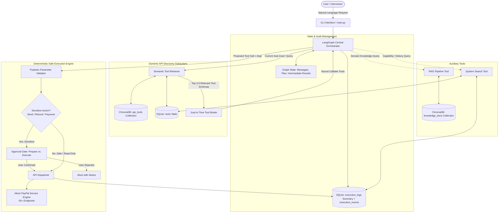
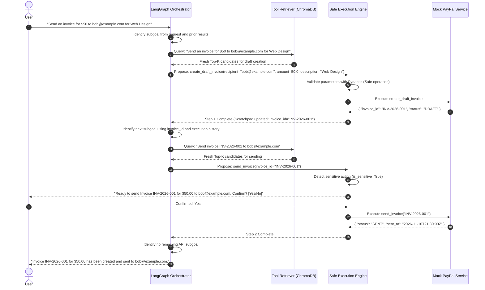

# Scalable Agentic System Architecture

## Graphical Interface

`streamlit_app.py` is a thin optional UI around the existing `ScalableAgentOrchestrator`. Agent Chat calls `orchestrator.run()`; Knowledge RAG and System Search call the existing `rag_tool.run()` and `system_search_tool.run()` methods directly so they remain distinct from API discovery and execution. The existing `main.py` CLI remains available.

The app stores a single orchestrator instance, chat transcript, current graph result, original pending request, and exact pending `AgentState` in that browser session's Streamlit session state. This preserves the orchestrator's in-memory authoritative approval record over reruns without globally sharing an orchestrator between users. Approve/Reject resumes through the existing `run(request, state=returned_state, approval_decision=...)` interface; the UI never rebuilds the pending action. A subsequent sensitive action replaces the pending state with its own fresh approval.

The UI renders the graph's existing redacted `planning_trace`; it does not generate a second trace. The chat transcript is display-only and is not passed as planner memory. If a browser session is lost, its pending approval cannot be resumed and the user must submit the request again. The UI uses mock PayPal execution and makes no live PayPal calls.

## 1. Executive Summary & Problem Formulation

Large Language Models (LLMs) experience severe performance degradation when inundated with massive collections of API tools (50+ to 1,000+ endpoints):
1. **Context Saturation & Latency:** Dumping 50 API schemas into a prompt consumes 15,000–30,000 tokens on every single turn, increasing latency and API costs.
2. **Attention Dilution & Choice Confusion:** LLMs struggle to distinguish between semantically similar API names and hallucinate arguments when overwhelmed with options.
3. **The Anti-Pattern:** Creating 50 to 500 individual AI agents (one per API) results in high communication overhead, routing complexity, and fragile execution graphs.

This system solves the challenge through a **Centralized Metadata-Driven Architecture**:
- APIs are stored as structured configuration records in **SQLite**.
- Semantic embeddings are computed using **Sentence Transformers (`all-MiniLM-L6-v2`)** and stored in **ChromaDB (`api_tools` collection)**.
- A **Single LangGraph Orchestrator** identifies the next sub-goal from the original request, execution history, and prior results, then retrieves only a bounded Top-K set for that sub-goal. The action planner receives only that step's candidates; prompt size is bounded by K, while actual token use depends on schema size.
- The configured LLM proposes one action from retrieved candidates at a time; execution remains deterministic and separately validates each proposal before dispatch.
- `LLM_PROVIDER=mock` uses the deterministic offline planner. OpenAI and Gemini calls use `LLM_PROVIDER` and `LLM_MODEL` from configuration; no real PayPal calls are made.

### 1.1. Provider data handling, privacy, and prompt injection

When OpenAI or Gemini is explicitly configured, provider requests can include:

- The original natural-language request (sent to intent classification, subgoal planning, and action planning).
- Retrieved API candidate names, descriptions, and parameter schemas (sent to action planning for the current subgoal).
- Successful execution history and scratchpad results, including identifiers and returned fields needed for dependent steps (sent to subgoal planning and action planning).
- Retrieved knowledge-document excerpts together with the user's question (sent to provider-backed RAG answering).

These are external disclosures to the selected provider under the credentials and service configuration supplied by the operator. The mock provider mode makes no external LLM calls. This project does not currently apply a general-purpose PII minimizer, provider-specific retention controls, or document sanitization before these prompt inputs are sent. Operators should treat requests and prior outputs as potentially sensitive.

Retrieved API definitions and knowledge excerpts are data, but may contain malicious or misleading instructions. Existing protections include bounded Top-K API retrieval, structured output schemas, checking the selected API against retrieved candidates, deterministic argument validation before dispatch, and exact-action approval for sensitive actions. RAG asks the model to answer from supplied excerpts and abstain when evidence is insufficient, but this is not a complete prompt-injection defense. These controls do not guarantee that a model will ignore hostile content or prevent disclosure through generated text. Recommended future work includes minimizing/redacting provider-bound context, treating retrieved content as explicitly untrusted data, adversarial prompt-injection tests, output disclosure checks, and review of provider retention/privacy settings. This documentation records the risk; it does not mitigate it.

---

## 2. Component Architecture Diagram



---

## 3. Core Component Responsibilities

### 3.1. Central LangGraph Orchestrator
- **Role:** Understands user requests, decomposes multi-step goals, coordinates retrieval, and synthesizes answers.
- **Workflow Nodes:**
  - `intent_analyzer`: Identifies whether the request needs API Discovery, RAG Documentation, or System Search.
  - `next_subgoal`: Uses the original request, completed execution history, and prior results to describe the next remaining API task.
  - `tool_retriever`: Retrieves a fresh Top-K candidate set for that sub-goal from ChromaDB/SQLite.
  - `planner_executor`: Receives only the current step's candidates, selects one API and proposes arguments, then executes after independent validation. Successful execution routes back through `next_subgoal` and fresh retrieval.
  - `synthesizer`: Generates clear, grounded final responses.
- **State Schema (`AgentState`):**
  - `messages`: Conversation history.
  - `current_subgoal`: The immediate operational task.
  - `active_tools`: Currently bound tool schemas (capped at $K \le 5$).
  - `scratchpad`: Intermediate execution outputs (e.g. `invoice_id = "INV-101"`).
  - `pending_approval`: Holds payload for sensitive actions awaiting human confirmation.

### 3.2. Dynamic Tool Discovery Subsystem
- **SQLite Tool Registry (`tools` table):**
  - Stores canonical API definitions: `tool_id`, `name`, `category` (`invoicing`, `payments`, `disputes`, `reporting`), `endpoint`, `http_method`, `description`, `parameter_schema`, `is_sensitive`, and `required_permissions`.
- **ChromaDB (`api_tools` collection):**
  - Indexes dense vector embeddings generated by Sentence Transformers (`all-MiniLM-L6-v2`) for all tool descriptions and trigger phrases.
- **Top-K Semantic Retriever:**
  - Converts the current sub-goal query to an embedding, queries ChromaDB for at most `TOP_K_TOOLS` candidates, checks confidence and fallback behavior, and fetches full parameter schemas from SQLite.
- **Just-In-Time (JIT) Tool Binder:**
  - Formats only retrieved candidates and their schemas for a planning turn, keeping the full catalog out of model context.

### 3.2.1. Opt-In CLI Planning Trace
- `main.py --verbose` displays the original request with common PII/credential patterns redacted and a per-step trace containing the identified subgoal, fresh retrieval query, retrieved candidates/scores, planner candidate names, selected API, execution/HTTP status, masked parameters, prior outputs, and returned output.
- The trace is held in graph state for the request and printed only when explicitly enabled. It does not add records or fields to SQLite audit storage. Redaction covers sensitive field names, email addresses, common user IDs, phone-like values, credential assignments, bearer tokens, and likely personal names; redaction is pattern-based and should not be treated as an NLP-grade PII detector.
- Approval state and execution arguments remain unchanged. The trace is a display copy; exact-action approval continues to use its authoritative in-memory pending action.

### 3.3. Safe Execution Subsystem (Independent of LLM)
- **Decoupled Architecture:** The LLM only *proposes* actions and arguments. It has zero direct access to network calls or database writes.
- **JSON Schema Validation:** Checks required fields, types, and enums before dispatch. Validation failure halts the current workflow with an error; automatic model repair is not implemented yet.
- **Prepare vs. Execute Approval Gate:**
  - Safe operations (`create_draft_invoice`, `list_disputes`, `get_transaction_summary`) execute automatically.
  - Sensitive operations (`send_invoice`, `capture_payment`, `refund_payment`) enter a **PREPARED** state and are shown to the CLI. The prompt has no default; execution requires the user to type `yes`.
- **Audit Logger:** Appends each action, validation failure, prepared approval, and execution result to SQLite `execution_events` with a unique `execution_id` and shared request `trace_id`. The legacy `execution_logs` table remains a latest-per-request summary, and old rows remain searchable.

### 3.4. Mock PayPal Service (Representative Handlers)
- The SQLite catalog contains 51 API definitions. The Python mock implements representative handlers and seed data; registered tools without handlers return `NOT_IMPLEMENTED_IN_MOCK`.
- Stateful Python service maintaining in-memory state for:
  - **Invoicing v2 (15+ APIs):** Draft, send, update, cancel, get details, list, record payment, remind.
  - **Payments & Captures v2 (15+ APIs):** Authorize, capture, refund, void, get transaction status.
  - **Disputes & Claims v1 (10+ APIs):** List disputes, get details, provide evidence, accept claim.
  - **Reporting & Balances v1 (10+ APIs):** Transaction history, account balances, monthly sales volume summary.

### 3.5. Auxiliary Tools (Separate Implementations)
- **RAG Pipeline Tool (`rag_pipeline_tool`):**
  - Retrieves local Markdown chunks from the isolated ChromaDB `knowledge_docs` collection and filters them by `RAG_SIMILARITY_THRESHOLD`.
  - In configured provider mode, asks the LLM to answer from those excerpts only; insufficient evidence produces an abstention. The system adds source references from retrieved metadata.
  - In `LLM_PROVIDER=mock` mode, returns the best matching passage as an explicitly labeled extractive answer; this mode does not claim to generate an LLM answer.
  - Remains independent from executable API discovery and does not call transactional APIs.
- **System Search Tool (`system_search_tool`):**
  - *Capability Mode:* Queries the SQLite `tools` table to answer questions like *"What invoice tools are available?"*.
  - *Audit Mode:* Queries SQLite `execution_events` for per-step history and can fall back to old `execution_logs` rows.

---

## 4. End-to-End Request-to-Execution Flows

### Scenario 1: Creating and Sending an Invoice (Multi-Step + Approval)


### Scenario 2: Retrieving Monthly Sales Volume
1. **User Request:** *"What was my total sales volume last month?"*
2. **Context Resolution:** Orchestrator normalizes "last month" to explicit ISO date ranges (`start_date="2026-10-01"`, `end_date="2026-10-31"`).
3. **Retrieval:** ChromaDB matches `get_transaction_summary` and `list_transactions`.
4. **Execution:** Executor validates and calls `get_transaction_summary(start_date="2026-10-01", end_date="2026-10-31")`.
5. **Response:** Sandbox returns aggregated volume and transaction count; orchestrator formats clean response.

### Scenario 3: Checking Customer Dispute Status
1. **User Request:** *"Is there a dispute open from user_123?"*
2. **Retrieval:** ChromaDB matches `list_disputes` and `get_dispute_details`.
3. **Execution:** Executor calls `list_disputes(customer_id="user_123", status="OPEN")`.
4. **Response:** Sandbox returns open dispute record with ID, amount, and reason; orchestrator presents findings.

---

## 5. Scaling from 50 to 500+ and Thousands of APIs

| Architectural Dimension | Naive Architecture (Dumping All Tools) | Our Dynamic Registry Architecture |
|---|---|---|
| **Tools Passed to LLM** | $N$ (50 to 500+ tools per prompt) | Constant $K \le 5$ tools per prompt |
| **Prompt Contents** | All $N$ API schemas | At most `TOP_K_TOOLS` retrieved schemas; token count depends on schema size |
| **Catalog Onboarding** | Rewrite prompt and routing code | Register metadata and reindex; a mock handler is still needed to execute a new mock API |
| **Retrieval Latency** | Model processes full catalog | Measured locally below; hardware and embedding cache affect results |
| **Selection Quality** | Depends on model and prompt | Depends on retrieval recall and model choice; live model selection accuracy is not yet benchmarked |


### 5.1. Latest Local Scalability Benchmark
Command: `pytest tests/test_scalability.py -q -s -p no:cacheprovider` (2026-11-11). This uses synthetic catalogs, a cached local embedding model, and five retrieval queries per scale:

```text
--- Empirical Scalability Benchmark Results ---
Scale:   51 tools | Latency: 21.22ms | Tools to LLM: 4 | Discovered: True
Scale:  501 tools | Latency: 23.76ms | Tools to LLM: 4 | Discovered: True
Scale: 2001 tools | Latency: 21.62ms | Tools to LLM: 4 | Discovered: True
```

The test passed at each size, returned four candidates, and found its target among them. These numbers measure retrieval and candidate count on this machine; they do not measure live LLM selection accuracy, production performance, or full API execution at these catalog sizes. The run printed blocked Hugging Face metadata retries but used cached embedding weights successfully.

Earlier benchmark figures remain in the historical Milestone 7 entry of `PROJECT_LOG.md`; the latest measurements above supersede them for current reporting.

The benchmark does not evaluate per-subgoal retrieval recall or live-model subgoal decomposition. The graph now retrieves a fresh bounded candidate set for each step, but the supplied benchmark measures synthetic single-query retrieval only.
